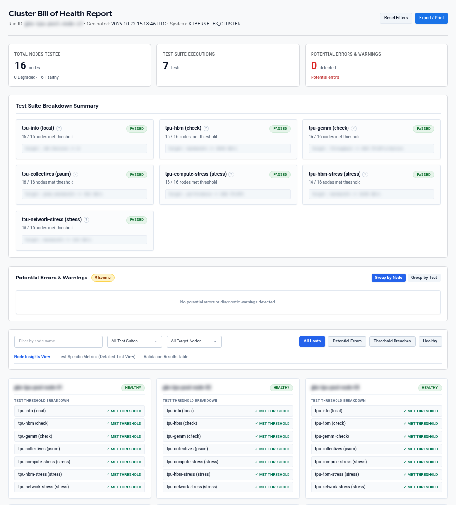

# Cluster Health Scanner (CHS)

Cluster Health Scanner (CHS) is an end-to-end diagnostic tool for evaluating the health, performance, and reliability of TPU and GPU hardware. It abstracts away the underlying infrastructure so that the same tool runs natively on Kubernetes (including Google Kubernetes Engine (GKE)), Slurm, and standalone TPU VMs, with a unified, deterministic approach to hardware validation.

> **Note:** Looking for the legacy v1 (`cluster_diag` / Helm `health_runner`) implementation? It is preserved under the [`legacy-archive`](https://github.com/GoogleCloudPlatform/cluster-health-scanner/tree/legacy-archive) tag.

## Why use CHS

- **Unified:** One tool, one set of commands, and one report format for TPUs and GPUs, including day-zero support for next-generation architectures.
- **Multiple environments:** Native support for Kubernetes, Slurm, and standalone TPU VMs. CHS automatically detects the scheduler and accelerator (machine type), so you don't need to specify them.
- **Scalable validation:** Scales seamlessly from isolating single-host faults to validating multi-node topologies and the networking between them.
- **Slicing support:** Full orchestration support for both dynamic and static TPU slice topologies on Kubernetes.
- **Safe by default:** Preflight checks validate the targets, and CHS tests only idle nodes, so running workloads aren't disrupted.
- **Clear verdicts:** CHS compares each metric with a precalibrated baseline for the accelerator and reports a clear health status for every test result instead of raw logs.
- **Extensible:** Plug-in architecture that lets users [add their own tests](docs/test-development.md).

## How CHS works

A run goes through three stages:

1. **Preflight.** Validates the target environment and selects only idle nodes with the same accelerator.
2. **Execution.** Runs the selected diagnostic tests across the target nodes.
3. **Evaluation and reporting.** Compares collected metrics with the [baseline thresholds](src/chs/platforms/README.md) for the accelerator and generates a human-readable **interactive health report** (`bill_of_health.html`) and a machine-readable **Bill of Health** (`bill_of_health.json`).

Sample interactive health report (`bill_of_health.html`):



### Limitations

- Multiple TPU slices can be tested in parallel in a single run, with a **max** topology per slice of `4x4x4` on TPU7x and `16x16` on TPU v6e.
- **Cross-slice testing** is not supported; each TPU slice is tested independently.

## Installation

Install CHS using either the Python package or the container image on the machine that runs the tests — **any machine with `kubectl` access** for Kubernetes, the **controller or login node** for Slurm, or **the TPU VM itself** for standalone mode (see [Where to run](#where-to-run) for environment setup).

### Option 1: Python package

> **Note:** Supported on **Kubernetes**, **Slurm**, and **standalone TPU VMs**. Requires [Python 3.12+](https://www.python.org/downloads/) and [`git`](https://git-scm.com/downloads). If your `python3` is older, see [Troubleshooting](docs/troubleshooting.md#python-312-is-not-available).
> - Standalone TPU VMs need **Python 3.12** exactly (not 3.13+) on x86_64: on other versions, CHS installs without the TPU test dependencies.

```bash
python3 -m venv chs-venv
source chs-venv/bin/activate
pip install git+https://github.com/GoogleCloudPlatform/cluster-health-scanner.git
```

To install a specific release from [GitHub Releases](https://github.com/GoogleCloudPlatform/cluster-health-scanner/releases) (for example, `v0.3.0`), append `@<VERSION>`:

```bash
pip install git+https://github.com/GoogleCloudPlatform/cluster-health-scanner.git@v0.3.0
```

### Option 2: Container image

> **Note:**
> - Requires [Docker](https://docs.docker.com/engine/install/).
> - On a standalone TPU VM running **Container-Optimized OS (COS)**, this is the only supported way to run CHS.
> - Not supported on **Slurm**; use the Python package.

Pull the container image:

```bash
docker pull us-docker.pkg.dev/gce-ai-infra/chs/chs:latest
```

To use a specific release from [GitHub Releases](https://github.com/GoogleCloudPlatform/cluster-health-scanner/releases) (for example, `v0.3.0`), replace `:latest` with the version without the `v` here and in the `chs` alias below:

```bash
docker pull us-docker.pkg.dev/gce-ai-infra/chs/chs:0.3.0
```

Define a `chs` alias so that `chs` commands can be run directly:

- **Kubernetes:** Mounts your `kubeconfig` and `gcloud` configuration read-only, persists run state in `chs-local-state`, and writes outputs to `./chs-output`:
  ```bash
  alias chs='docker run --rm -it --network host \
    -v ~/.kube:/workspace/.kube:ro \
    -v ~/.config/gcloud:/workspace/.config/gcloud:ro \
    -v chs-local-state:/workspace/.local/share \
    -v "$(pwd)/chs-output":/workspace/chs-output \
    us-docker.pkg.dev/gce-ai-infra/chs/chs:latest'
  ```
- **Standalone (TPU VM):** Grants access to the VM's TPU devices and host PID namespace, persists run state in `chs-local-state`, and writes outputs to `./chs-output`:
  ```bash
  alias chs='docker run --rm -it --privileged --pid=host \
    -v /:/host \
    -v chs-local-state:/workspace/.local/share \
    -v "$(pwd)/chs-output":/workspace/chs-output \
    us-docker.pkg.dev/gce-ai-infra/chs/chs:latest'
  ```

## Where to run

Where you run CHS depends on the environment that you're testing:

- **Kubernetes:** Run CHS from **any machine with `kubectl` access** to the cluster, such as your **local machine** or **Cloud Shell**. Authenticate and fetch cluster credentials before running:
  ```bash
  gcloud auth application-default login
  gcloud container clusters get-credentials <cluster_name> --location <region_or_zone> --project <project_id>
  ```
- **Slurm:** Run CHS on the **Slurm controller or login node**, where `sinfo` and `sbatch` are available. Configure **Enroot credentials** on the cluster so nodes can pull diagnostic test images from `us-docker.pkg.dev`:
  ```bash
  gcloud auth configure-docker us-docker.pkg.dev
  mkdir -p ~/.enroot
  cat <<EOF > "${HOME}/.enroot/.credentials"
  machine us-docker.pkg.dev login oauth2accesstoken password $(gcloud auth application-default print-access-token)
  EOF
  ```
- **Standalone (TPU VM):** Run CHS **directly on the TPU VM**, which must expose TPU devices under `/dev/vfio`. Run as `root` or raise the **memlock limit** (`ulimit -l unlimited`) before running native TPU tests.

### Required IAM roles (Google Cloud)

| Role | Required for | Purpose |
| --- | --- | --- |
| **Kubernetes Engine Developer** (`roles/container.developer`) | **Kubernetes** | Create and clean up diagnostic jobs and resources on the cluster. |
| **Compute Viewer** (`roles/compute.viewer`) | **Kubernetes**, **Slurm** | Read Compute Engine node metadata and topology. |
| **Storage Object Admin** (`roles/storage.objectAdmin`) | **Optional** (GCS bucket) | Upload result artifacts when GCS storage is configured. |

## Quickstart

> **Tip:** Append `--help` to any command for detailed usage, or see the [CLI reference](docs/cli.md) for all commands and options.

### 1. List suites and tests

List the predefined suites and the individual tests:

```bash
chs list suites
chs list tests
```

### 2. Run diagnostics

Run a suite (`lite` or `standard`) on your cluster or TPU VM:

- **Kubernetes:**

  ```bash
  chs run --nodepools=NODE_POOL_NAMES --suite=lite
  ```

- **Slurm:**

  ```bash
  chs run --partitions=PARTITION_NAMES --suite=lite
  ```

- **Standalone (TPU VM):**

  ```bash
  chs run --suite=lite
  ```

To run individual tests instead of a suite, use `--tests`:

```bash
chs run --nodepools=NODE_POOL_NAMES --tests=tpu-info,tpu-hbm
```

Replace the following:

- `NODE_POOL_NAMES`: a comma-separated list of the Kubernetes node pools to test.
- `PARTITION_NAMES`: the Slurm partitions to test.

### 3. View results

Print the locations of a run's interactive health report (`bill_of_health.html`) and Bill of Health (`bill_of_health.json`):

```bash
chs results
```

### Optional: Cancel a run

Cancel your most recent run, stopping its jobs and cleaning up its resources:

```bash
chs cancel
```

## Telemetry

CHS sends anonymous usage metrics to help improve the tool. It doesn't collect personally identifiable information (PII). Telemetry is on by default; run `chs configure telemetry disable` or set `CHS_TELEMETRY=0` to opt out. See [Telemetry](docs/telemetry.md) for what is sent.

## Documentation

- [CLI reference](docs/cli.md)
- [Tests and suites](src/chs/tests/README.md)
- [Machine types and thresholds](src/chs/platforms/README.md)
- [Troubleshooting](docs/troubleshooting.md)
- [Telemetry](docs/telemetry.md)

## Support

See [SUPPORT.md](SUPPORT.md) for how to report bugs and ask questions.

## Contributing

See [CONTRIBUTING.md](CONTRIBUTING.md) and [docs/development.md](docs/development.md). For adding your own test, see the [Test development guide](docs/test-development.md).
